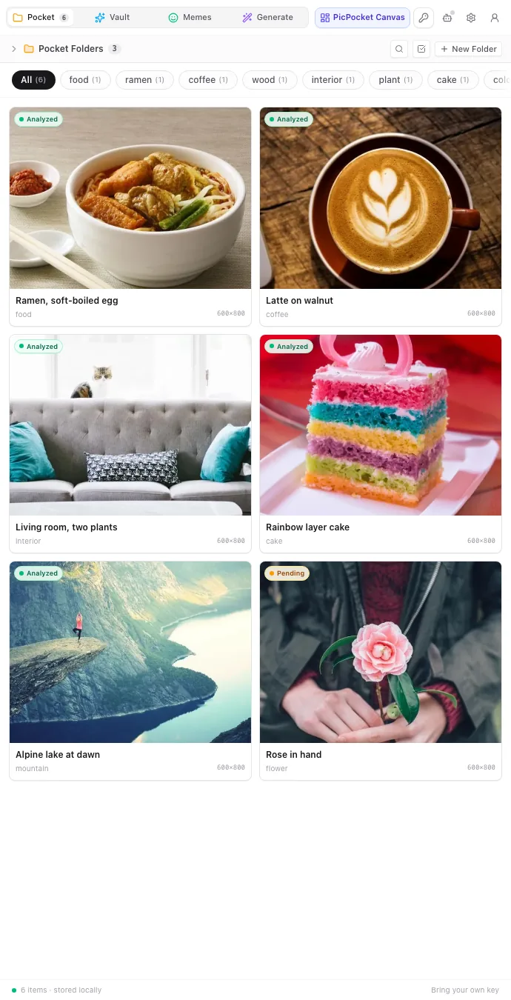
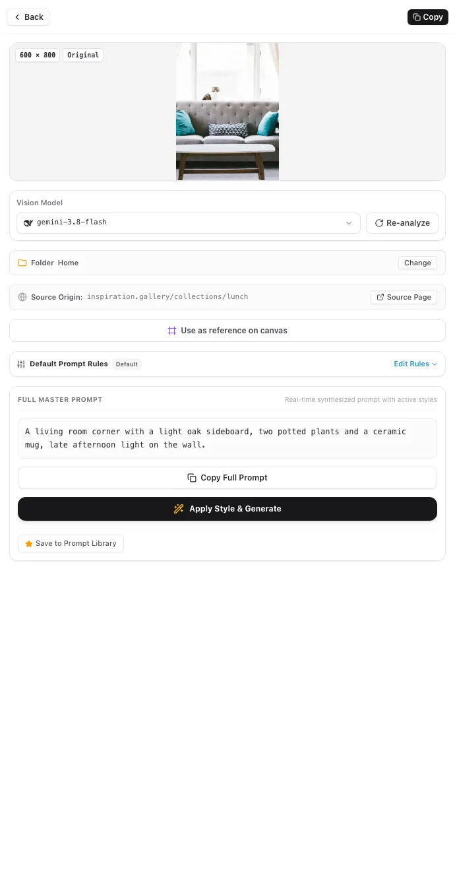
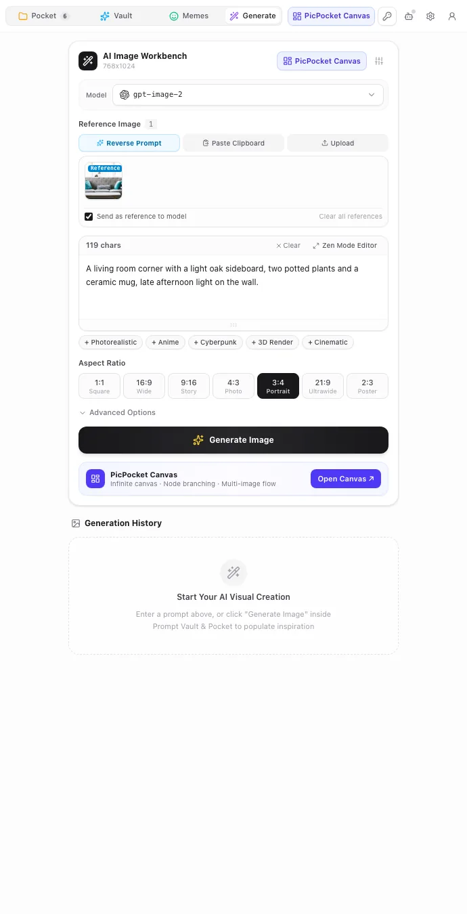

<p align="center">
  
</p>

<h1 align="center">PicPocket</h1>

<p align="center">
  <b>Local-first&nbsp;&nbsp;|&nbsp;&nbsp;One complete prompt&nbsp;&nbsp;|&nbsp;&nbsp;Bring your own key&nbsp;&nbsp;|&nbsp;&nbsp;MCP</b>
</p>

<table>
  <tr>
    <td width="50%" align="center"></td>
    <td width="50%" align="center"></td>
  </tr>
  <tr>
    <td align="center"><sub>The pocket keeps every image you save.</sub></td>
    <td align="center"><sub>Each one carries a prompt you can paste.</sub></td>
  </tr>
</table>

<p align="center">
  <b>A Chrome side panel that turns the images you find on the web into prompts you can paste.<br>Your pocket lives in your browser. With your own key, requests never touch our servers.</b>
</p>

<p align="center">
  <a href="https://chromewebstore.google.com/detail/picpocket-image-to-prompt/bncoffcoihlpfbicajogmpcdckcfpnfa"></a>
  <a href="https://github.com/QingYunA/picpocket/stargazers"></a>
  
</p>

<p align="center">
  <a href="https://www.picpocket.top"><b>Website</b></a> · <a href="#install">Install</a> · <a href="#what-you-capture-what-you-get">Examples</a> · <a href="#features">Features</a> · <a href="#agents-mcp">Agents</a> · <a href="#development">Develop</a> · <a href="README.zh-CN.md">简体中文</a>
</p>

Once installed, this is the whole loop:

```
> Hover an image and click Reverse in the pill. Or right-click → Collect to PicPocket & Reverse.
> Open the side panel. The image is saved and its prompt is being written.
> Copy. Paste into Midjourney, Flux, Grok, or your own generator.
```

A 13-second walkthrough of the same loop is on the [website](https://www.picpocket.top/#tour).

A vision model reads the image and writes one paragraph in plain English. It covers subject, style, lighting and composition together, the way you would describe the picture to another person. No tags, no sliders, no six boxes to fill in.

## Why not just screenshot and ask a chatbot?

You can. A chatbot will describe the image. But the description lands in a chat thread, in a shape you have to rewrite, and the image stays in your Downloads folder with a name like `image (7).png`.

PicPocket keeps the two together. The image is the record, the prompt is attached to it, and both live in the same panel you are already looking at. You also get folders, tags and search, so the tenth image is as easy to find as the first.

What it does not do: it is not a gallery for watching art, and it is not a prompt marketplace. It is one pocket for the images you want to keep, with the words to remake them.

## Install

PicPocket runs in Chrome. It needs no account to save images, and no key to start collecting.

### From the Chrome Web Store (recommended)

Open the [PicPocket listing](https://chromewebstore.google.com/detail/picpocket-image-to-prompt/bncoffcoihlpfbicajogmpcdckcfpnfa) and click **Add to Chrome**. Chrome keeps it up to date.

To reverse an image into a prompt you need one AI endpoint. Two ways:

- **Your own key.** Add any OpenAI-compatible endpoint and key under Settings → Models. Requests go from your browser to that provider. DeepSeek, OpenAI and self-hosted gateways work.
- **The hosted channel.** Until you add a key, this is what PicPocket uses. Sign in for 30 credits a month; your email must verify first. Those requests go through PicPocket's server, as the [privacy policy](PRIVACY.md) explains.

### From source

You need [Bun](https://bun.sh) 1.3 or newer. Nothing else.

```bash
git clone https://github.com/QingYunA/picpocket.git
cd picpocket
bun install          # also installs the bundled canvas app
bun run build        # typecheck + canvas + extension → dist/chrome-mv3
```

Then open `chrome://extensions`, turn on **Developer mode**, click **Load unpacked**, and pick `dist/chrome-mv3`.

## What you capture, what you get

| The image you save | The prompt you get back |
| :--- | :--- |
| A food photo from a recipe blog | "A bowl of ramen with a soft-boiled egg on a light wooden table, soft window light, shallow depth of field, overhead angle." |
| A design reference from a portfolio | Subject, style, lighting and framing in one paragraph, with lens and depth of field when they matter |
| A saved wallpaper from a travel page | The scene, the light and the palette, ready to re-render in another aspect ratio |
| A screenshot of a chart | Mostly the scene. Text in the image can come through as quoted words |
| A still from a video or a GIF | The frame only. PicPocket reads images, not timelines |

The last two rows are the limits: it describes the picture, and it works on still images only.

## Features

- **Two ways to save.** A pill appears when you hover a large image; the right-click menu offers *Collect to PicPocket* and *Collect to PicPocket & Reverse*. Choose which menu items you want in settings.
- **One complete prompt.** The vision model writes a paragraph that already includes subject, style, lighting and composition, so there is nothing to assemble by hand. Copy it in one click, or send it to the workbench with the original as reference.
- **A pocket you can search.** Folders, tags and a filter bar. Thumbnails are capped at 400 px on the long edge and stored as WebP, so the gallery opens fast.
- **A prompt library.** Four sources are built in. One is a small curated set that is on by default; the other three are open-source collections ([YouMind](https://github.com/YouMind-OpenLab/awesome-gpt-image-2), [Nano Banana Pro](https://github.com/YouMind-OpenLab/awesome-nano-banana-pro-prompts), [Freestylefly](https://github.com/freestylefly/awesome-gpt-image-2)) that you switch on, which then fetch from a CDN.
- **A workbench.** Pick a model, set the aspect ratio, add style hints, keep a reference image, and generate without leaving the page you are on. Generation history is kept locally.
- **An infinite canvas.** Send any image or prompt to a full-page canvas, duplicate a node into several versions, and compare them side by side. The canvas is a modified copy of [infinite-canvas](https://github.com/basketikun/infinite-canvas); that upstream is MIT, our changes ship under GPL-3.0-only.
- **A meme library.** Sync a public index from memegen, search it locally, and drop the result into the pocket or the canvas. The index stores addresses, so the picture loads from wherever it is hosted; save one to the pocket and it is downloaded and kept locally.
- **Two languages.** The interface is in English and Simplified Chinese.

<p align="center"></p>

<p align="center"><sub>The workbench: pick a model, keep the reference, then generate without leaving the page.</sub></p>

## Agents (MCP)

PicPocket ships a local MCP server, so a coding agent can read and write the same pocket you do. It exposes eight tools: `search_prompts_and_assets`, `save_asset`, `save_prompt`, `update_tags`, `manage_folders`, `generate_and_save_asset`, `get_canvas_state` and `create_canvas_node`.

```bash
bun run mcp:install cursor      # or claude / roo / antigravity / windsurf / zed / cline
```

The bridge listens on 127.0.0.1 and talks to the extension over a local WebSocket. Calls that generate an image go to your model provider, like any other generation. Details: [docs/adr/0008-local-mcp-agent-collaboration.md](docs/adr/0008-local-mcp-agent-collaboration.md).

## Where your data lives

| What | Where |
| :--- | :--- |
| Images, prompts, folders, tags | IndexedDB in your browser ([Dexie](https://dexie.org)) |
| API keys and settings | `chrome.storage.local` |
| Requests with your own key | Your browser to your provider, directly |
| Requests on the hosted channel | Your browser to PicPocket's server |

Uninstalling the extension removes what it stored. You can export and restore a backup from settings. The backup never contains API keys.

The full policy is in [PRIVACY.md](PRIVACY.md). The hosted channel (accounts, credits, payments) runs on a separate private backend. It is not part of this repository, and the two sides only talk over HTTP. The parts documented so far are in [docs/api-contract.md](docs/api-contract.md).

## Development

```bash
bun install
bun run dev          # WXT dev server with HMR
bun run typecheck    # extension + canvas
bun run test         # i18n scan, unit tests, canvas tests
bun run build        # typecheck, canvas build, extension build, remote-code check
bun run zip          # the store package
```

`bun run build` fails if the bundle references remote code. Architecture decisions are in [docs/adr/](docs/adr/), the domain vocabulary in [GLOSSARY.md](GLOSSARY.md), and the collaboration rules in [CONTRIBUTING.md](CONTRIBUTING.md).

## Background

You see a striking image on a web page and you want its prompt. The usual path is a lot of steps: save the screenshot, open a chat, upload the file, ask the model to describe it, read a rambling paragraph, then pick the useful words out by hand.

The picture stays and the reason goes. A week later you still have the image and you cannot say what made it good.

PicPocket puts that whole path inside the side panel, and keeps the prompt next to the image it came from. The rest of the app exists to make the habit cheap.

## License

[GPL-3.0-only](LICENSE). Versions published before the switch remain available under MIT.

The canvas started as [basketikun/infinite-canvas](https://github.com/basketikun/infinite-canvas), which is MIT; the modified copy in this repository is GPL-3.0-only like the rest. The upstream notice is kept in [vendor/infinite-canvas/LICENSE](vendor/infinite-canvas/LICENSE). Other components are listed in [THIRD_PARTY_NOTICES.md](THIRD_PARTY_NOTICES.md).

The name "PicPocket" and the logo are not covered by the GPL. Fork the code freely, but do not publish a derived build under this name or logo.
