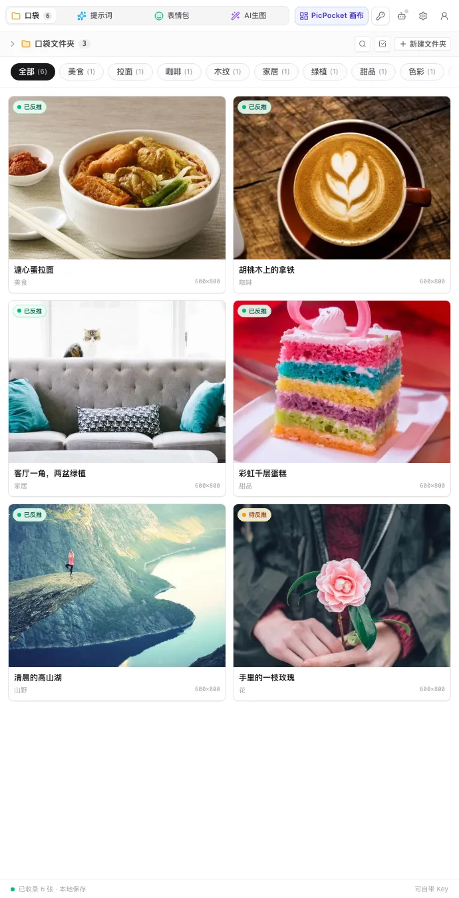
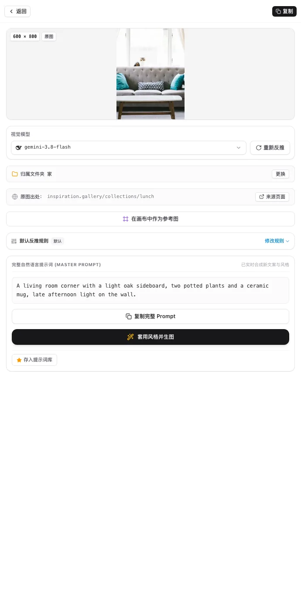
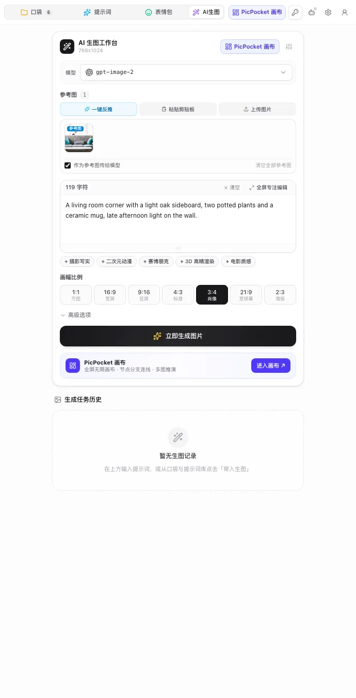

<p align="center">
  
</p>

<h1 align="center">PicPocket</h1>

<p align="center">
  <b>本地优先&nbsp;&nbsp;|&nbsp;&nbsp;一段完整提示词&nbsp;&nbsp;|&nbsp;&nbsp;自带 Key&nbsp;&nbsp;|&nbsp;&nbsp;MCP</b>
</p>

<table>
  <tr>
    <td width="50%" align="center"></td>
    <td width="50%" align="center"></td>
  </tr>
  <tr>
    <td align="center"><sub>口袋收下你存的每一张图。</sub></td>
    <td align="center"><sub>每张图都带着一段能直接用的提示词。</sub></td>
  </tr>
</table>

<p align="center">
  <b>一个 Chrome 侧边栏，把你在网页上看到的图，变成能直接粘贴的提示词。<br>口袋存在你的浏览器里。填了自己的 Key，请求不经过我们的服务器。</b>
</p>

<p align="center">
  <a href="https://chromewebstore.google.com/detail/picpocket-image-to-prompt/bncoffcoihlpfbicajogmpcdckcfpnfa"></a>
  <a href="https://github.com/QingYunA/picpocket/stargazers"></a>
  
</p>

<p align="center">
  <a href="https://www.picpocket.top"><b>官网</b></a> · <a href="#安装">安装</a> · <a href="#你会存下什么拿回什么">示例</a> · <a href="#功能">功能</a> · <a href="#给-agent-用mcp">Agent</a> · <a href="#开发">开发</a> · <a href="README.md">English</a>
</p>

装好之后，整件事就三步：

```
> 鼠标悬停在网页任意大图上，点胶囊里的「反推」。或者右键 →「收集到 PicPocket 并反推」。
> 打开侧边栏，图已入库，提示词正在写。
> 复制，粘进 Midjourney、Flux、Grok，或者你自己的生图工具。
```

同样的流程有一段 13 秒的实拍演示，在[官网](https://www.picpocket.top/#tour)。

视觉模型读一遍图，写出一段英文。主体、风格、光影、构图都在里面，像你当面跟人描述这张图。没有标签要拼，也没有六个格子要填。

## 为什么不直接截图问 AI？

可以。聊天机器人也会描述这张图。但描述落在聊天记录里，形状还得你自己改；图留在下载文件夹，名字叫 `image (7).png`。

PicPocket 把两样东西放在一起。图是记录，提示词挂在图上，都在你正在看的那个面板里。再加上文件夹、标签和搜索，第十张图和第一张一样好找。

它不做什么：不是用来看画的画廊，也不是提示词市场。它只是一个口袋，装你想留的图，和重做这张图的那段话。

## 安装

PicPocket 跑在 Chrome 里。存图不需要账号，也不需要先填 Key。

### 从 Chrome 应用商店安装（推荐）

打开 [PicPocket 商店页](https://chromewebstore.google.com/detail/picpocket-image-to-prompt/bncoffcoihlpfbicajogmpcdckcfpnfa)，点 **添加至 Chrome**。之后由 Chrome 自动更新。

反推图片需要接一个大模型。两种方式：

- **自带 Key。** 在「设置 → 模型」里填任何 OpenAI 兼容的接口和 Key。请求从你的浏览器直接发到那家服务商，DeepSeek、OpenAI 和自建网关都能用。
- **官方托管通道。** 还没填 Key 时用的就是它。登录后每月 30 积分，需要先验证邮箱。这部分请求经过 PicPocket 的服务器，说明见[隐私政策](PRIVACY.md)。

### 从源码构建

需要 [Bun](https://bun.sh) 1.3 或更新版本，其他什么都不用装。

```bash
git clone https://github.com/QingYunA/picpocket.git
cd picpocket
bun install          # 顺带装好内置画布
bun run build        # 类型检查 + 画布 + 扩展 → dist/chrome-mv3
```

然后打开 `chrome://extensions`，打开右上角**开发者模式**，点**加载已解压的扩展程序**，选 `dist/chrome-mv3`。

## 你会存下什么，拿回什么

| 存下的图 | 拿回的提示词 |
| :--- | :--- |
| 菜谱博客里的一碗面 | 「一碗拉面，溏心蛋，浅色木桌，柔和窗光，浅景深，俯拍。」 |
| 作品集里的设计参考 | 主体、风格、光影、构图合成一段，摄影类还会写明镜头和景深 |
| 旅行页存下的壁纸 | 场景、光线、色调都在，可以换成别的比例重画 |
| 一张图表的截图 | 主要是画面。图里的文字可能被引号抄进描述 |
| 视频里的一帧、一张动图 | 只取静帧。PicPocket 读的是图片，不是时间轴 |

最后两行是边界：它描述画面，只处理静图。

## 功能

- **两种存法。** 悬停大图会出现胶囊；右键给出「收集到 PicPocket」和「收集到 PicPocket 并反推提示词」。在设置里可以只留你想要的那项。
- **一段完整提示词。** 视觉模型写出一整段，主体、风格、光影、构图已经在里面，不用手工拼。一键复制，或者带着原图送去工作台。
- **能搜的口袋。** 文件夹、标签、筛选条。缩略图长边最大 400px，存成 WebP，图库打开快。
- **提示词库。** 内置四个源：一套本地精选默认开启；另外三套是开源集合（[YouMind](https://github.com/YouMind-OpenLab/awesome-gpt-image-2)、[Nano Banana Pro](https://github.com/YouMind-OpenLab/awesome-nano-banana-pro-prompts)、[Freestylefly](https://github.com/freestylefly/awesome-gpt-image-2)），需要手动开启，开启后从 CDN 拉取。
- **工作台。** 选模型、选比例、加风格词、挂参考图，不离开当前网页就能出图。生成记录留在本地。
- **无限画布。** 把任意图或提示词送进整页画布，复制一个节点成多个版本，并排比。画布基于 [infinite-canvas](https://github.com/basketikun/infinite-canvas) 修改：上游是 MIT，这份改动按 GPL-3.0-only 发布。
- **表情包库。** 从 memegen 同步公开索引，本地搜索，一键丢进口袋或画布。索引里只存地址，预览从原站加载；存进口袋时会下载并留在本地。
- **两种语言。** 界面支持中英双语。

<p align="center"></p>

<p align="center"><sub>工作台：选好模型，留着参考图，不离开当前网页就出图。</sub></p>

## 给 Agent 用（MCP）

PicPocket 自带一个本地 MCP 服务，编码 Agent 可以读写你同一个口袋。它提供八个工具：`search_prompts_and_assets`、`save_asset`、`save_prompt`、`update_tags`、`manage_folders`、`generate_and_save_asset`、`get_canvas_state`、`create_canvas_node`。

```bash
bun run mcp:install cursor      # 也可以 claude / roo / antigravity / windsurf / zed / cline
```

桥接只监听 127.0.0.1，走本机 WebSocket。会出图的那种调用照常发给你的模型服务商。细节见 [docs/adr/0008-local-mcp-agent-collaboration.md](docs/adr/0008-local-mcp-agent-collaboration.md)。

## 数据放在哪

| 内容 | 位置 |
| :--- | :--- |
| 图片、提示词、文件夹、标签 | 浏览器 IndexedDB（[Dexie](https://dexie.org)） |
| API Key 与设置 | `chrome.storage.local` |
| 自带 Key 的请求 | 你的浏览器直连服务商 |
| 托管通道的请求 | 你的浏览器到 PicPocket 服务器 |

卸载扩展会清掉它存的东西。设置里可以导出和恢复备份，备份里不含 API Key。

完整说明在 [PRIVACY.md](PRIVACY.md)。托管通道（账号、积分、支付）跑在独立的私有后端，不在本仓库里，两边只通过 HTTP 对接，目前写进 [docs/api-contract.md](docs/api-contract.md) 的是其中一部分。

## 开发

```bash
bun install
bun run dev          # WXT 开发服务，热更新
bun run typecheck    # 扩展 + 画布
bun run test         # 文案扫描、单元测试、画布测试
bun run build        # 类型检查、画布、扩展、远程代码检查
bun run zip          # 商店安装包
```

只要产物里引用了远程代码，`bun run build` 就会失败。架构决策在 [docs/adr/](docs/adr/)，术语表在 [GLOSSARY.md](GLOSSARY.md)，协作规范在 [CONTRIBUTING.md](CONTRIBUTING.md)。

## 起因

在网页上看到一张惊艳的图，你想要它的提示词。但正常的路很长：存截图、开对话框、上传、让模型描述、读一段啰嗦的话，再自己挑出有用的词。

图留下了，原因没留下。一周后图还在，你说不出它好在哪。

PicPocket 把这一整条路搬进侧边栏，并让提示词一直跟着那张图。其余功能都是为了让这个动作便宜。

## 开源协议

[GPL-3.0-only](LICENSE)。切换协议之前发布的版本仍可按 MIT 使用。

画布起自 [basketikun/infinite-canvas](https://github.com/basketikun/infinite-canvas)（上游 MIT）；本仓库里的改动版和其余代码一样按 GPL-3.0-only 发布，上游声明保留在 [vendor/infinite-canvas/LICENSE](vendor/infinite-canvas/LICENSE)。其余组件见 [THIRD_PARTY_NOTICES.md](THIRD_PARTY_NOTICES.md)。

「PicPocket」名称与 Logo 不在 GPL 授权范围内。代码可以随便改，但请不要用这个名字和 Logo 发布衍生版本。
